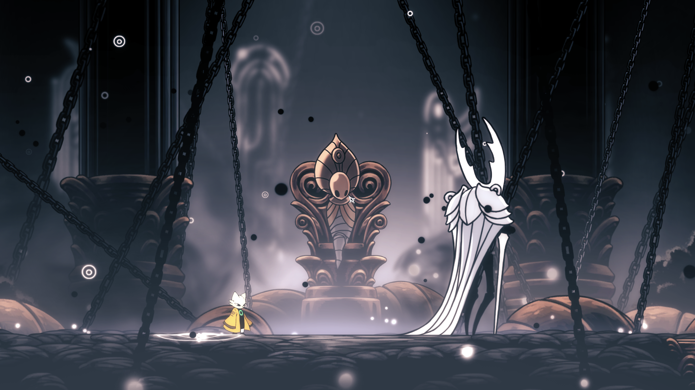
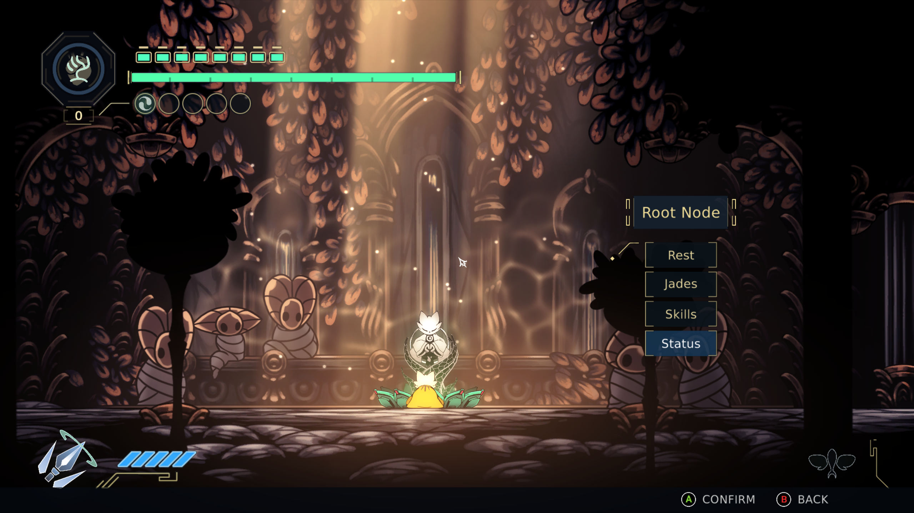

> **AI-generated project:** All original Hollow Sols code was generated by AI, with no human-written code. Development used Astra 6.0 and Sol 6.1 at Medium or High reasoning effort, depending on task complexity. Human involvement provided project direction, playtesting, and feedback.

<h1 align="center">Hollow Sols</h1>

<strong>Yi meets the gods of Hallownest.</strong>

  <a href="docs/INSTALLATION.md">Installation</a> ·
  <a href="docs/ROSTER-COMPLETION.md">Progress &amp; known limitations</a> ·
  <a href="https://github.com/emmveepee/Hollow-Sols-Godhome/issues/new/choose">Report an issue</a> ·
  <a href="https://ko-fi.com/mostvaluedplayer">Support on Ko-fi</a>

Nine Sols and Hollow Knight are my two favorite games. The moment I heard about passthrough mods, I knew I wanted to combine them.

Hollow Sols brings the real Yi into **Hollow Knight's Godhome**. Both games run together: Nine Sols handles Yi's movement, combat and abilities, while Hollow Knight runs its world and bosses.

**v0.1.0 is being prepared for release.** This is a local, offline, single-player mod for Windows.

<em>A familiar opponent. A different set of tools.</em>

## Making Yi feel at home

Yi's kit depends on getting close, holding his ground and responding to attacks. Hollow Knight's usual passive contact damage gets in the way of that playstyle, so **simply touching a boss does not hurt Yi**. Active attacks and hazards still matter.

My aim is to preserve Hollow Knight's native attack timings, patterns and speed as closely as possible, while adapting the interactions needed to make Yi feel right in combat. I've balanced those adaptations around what I found fun and fair, and I welcome feedback on mechanics and balance.

Yi starts fully upgraded. **Not every jade has been tested:** some may behave incorrectly or fail to work.

<em>A little piece of New Kunlun in Godhome.</em>

## Current progress and future plans

All 44 listed boss encounters are currently playable and satisfactory. Further fight adjustments will follow playtesting and feedback; see the [approved roster and remaining validation](docs/ROSTER-COMPLETION.md).

The goal is to make Yi playable throughout **all of Godhome**, including every boss, Pantheon and binding. Individual boss completion does not mean every Pantheon sequence or binding is finished.

There are currently no plans to adapt the rest of Hollow Knight's campaign. The [v0.2.0 roadmap](docs/ROADMAP.md) describes the planned reusable bridge architecture.

<em>Another sun to face.</em>

## Play and share feedback

You need legitimate Steam installations of **both games** and **BepInEx 5.4.23.5 Windows x64**, installed separately for each game. Follow the [installation, verification and removal guide](docs/INSTALLATION.md) for supported builds and setup.

Launch both games through Steam, let both reach their main menus, then choose **Hollow Sols Bridge** in either game. Hollow Knight manages four isolated mod-owned paired slots; Nine Sols follows. Vanilla and previous development saves stay separate. Yi's controls are available through **Nine Sols Controls** in Hollow Knight's pause menu.

Unexpected bridge failures offer **Prepare Bug Report**, which prepares a diagnostic ZIP and opens a prefilled issue form. Inspect the ZIP, attach it, describe what happened, and submit. Wait for GitHub to show the attachment link before submitting. Preparing a report never uploads it automatically.

Public builds keep ordinary bounded logs and exclude the F9 debug menu and detailed-capture activation. See [bug reporting](docs/BUG-REPORTING.md) for configuration, privacy and local fallbacks. You can also use [GitHub Issues](https://github.com/emmveepee/Hollow-Sols-Godhome/issues) for feedback. During private staging, repository access is required.

## Support my projects

If you enjoy Hollow Sols and want to support my current and future vibe-coding adventures in game modding, any bit helps.

**[Support me on Ko-fi](https://ko-fi.com/mostvaluedplayer)**

---

**For contributors:** [Build and check instructions](CONTRIBUTING.md) · [Documentation map](docs/DOCUMENTATION.md)

Original project-owned code and documentation are **GPL-3.0-or-later**. See [LICENSE](LICENSE) and [third-party notices](THIRD-PARTY-NOTICES.md). The banner and screenshots depict game artwork; the project code license grants no rights to that underlying material. Game content and third-party dependencies retain their own rights and terms. The software is provided without warranty.
